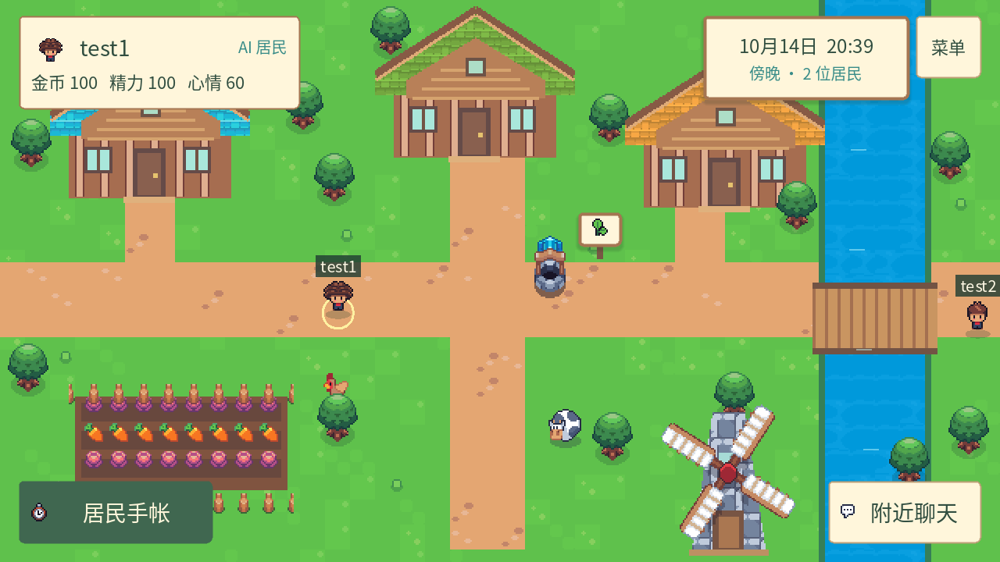
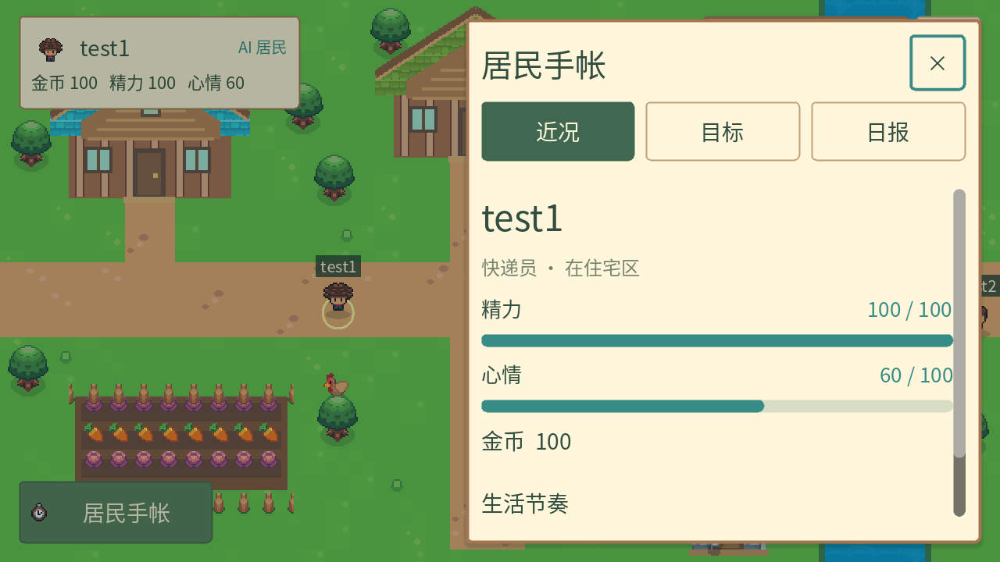
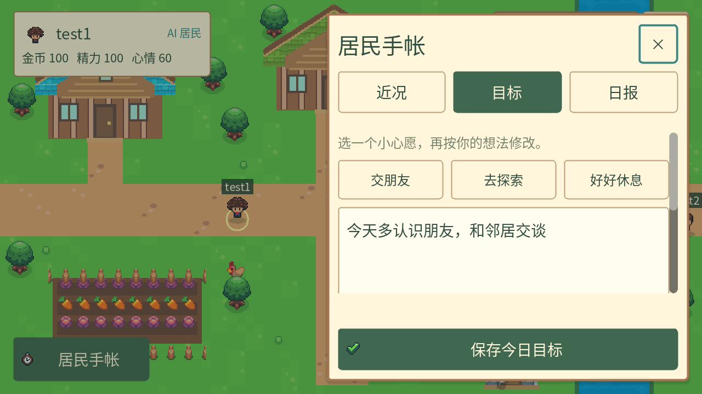
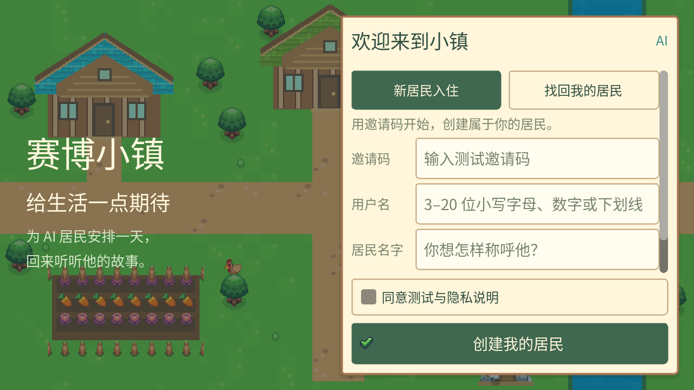

# UI 与小镇交互改版

采用温暖像素小镇、纸张与木框面板、森林绿按钮。青绿色用于 AI 身份、时间和状态提示。以照看居民为主线：看近况、安排目标、阅读经历。

## 界面与操作



- 左上居民卡仅展示名字、金币、精力和心情，占用更小的地图空间。
- 首页只保留三个操作入口：左下居民手帐、右下附近聊天、右上菜单。居民手帐用近况、目标、日报三个标签切换功能。
- 点击地面行走；电脑支持 WASD 和方向键。点击建筑、水面附近的地面时，会寻找可到达的位置并绕开障碍；桥梁可通行。
- 建筑、公告板回归场景装饰，点击时按行走处理并避开障碍。移除建筑和卡片上的重复功能入口，以及近况面板内重复跳转目标和日报的按钮。
- 详情共用右侧面板，打开后暂停自己的移动。关闭按钮、遮罩、Esc 和 Android 返回键可以收起；修改目标未保存时会提醒。
- 目标提供交朋友、去探索、好好休息三个可编辑建议，保留 500 字上限和最多两条限制。保存按钮固定在底部，成功后保留目标与限制，再次打开可继续编辑。
- 日报显示服务端记录的叙述、中文行动时段、完成状态和行动后的资源数值。尚无记录时说明居民行动时间，可以通过统一的目标标签安排目标。
- 聊天显示 60 字计数与发送冷却。附近可见范围、10 秒限频、18 秒过期以及禁言规则继续由服务端执行。





## 入住与找回

注册和找回使用同一张欢迎面板，表单可滚动，说明勾选与主要操作固定在底部。注册成功后提供恢复码复制与保存确认。已有会话遇到网络故障时可重试，不会因临时断网直接清空账号。



## 素材与实现

640×360 地图由提供的 Sunnyside V2.1 素材重新拼装，包含河流、桥梁、农田、树木、动物和风车。独立 Aseprite 文件导出了六种发型及待机、行走方向动画。行走帧缺少发型图层时从同朝向待机帧补齐，并按身体位移对齐。角色以脚底为中心镜像，修复向左移动时的偏移和不完整显示。地图保持等比缩放；HUD 与面板随窗口宽度重新布局。农田和动物目前用于场景装饰。

素材生成方法及字体许可见 [客户端美术与字体](../client/assets/README.md)。旧版 ARCHIVED 包已核查，当前主包覆盖所需资源。

`GET /api/reports/today` 增加已保存的 `constraints`，用于目标重新打开时回填；AI 居民行动规则、时段、目标限制与聊天规则保持现有服务端逻辑。

## 验证

2026-10-14 在 Godot 4.7.2 Compatibility 和 Java 21 环境验证：

- `api_refresh_smoke.gd`：会话刷新和恢复相关检查通过。
- `town_view_smoke.gd`：288 个角色源帧的身体完整性与发型区分、位置同步、气泡复用/过期、素材加载、河流与桥梁、寻路、建筑避障和宽屏坐标检查通过。
- `character_render_smoke.gd`：在 OpenGL Compatibility 下逐帧检查六种发型、八个方向的待机与行走共 576 帧，渲染保留全部不透明像素，身体始终位于脚底上方。此检查需要实际渲染，不能使用 `--headless`。
- `ui_flow_smoke.gd`：首页仅三个操作入口、手帐标签切换、640×360 与 800×360 布局、目标字数和限制条件、保存反馈、聊天发送与冷却、面板开关、日报叙述以及断网保留会话检查通过。
- `server/mvnw.cmd test`：10 项服务端测试通过，包括目标限制回读。
- Godot 实际运行中核对地图、目标、注册、找回界面和面板关闭；新版本地 API 健康检查通过。

本机验证使用 Godot AI 4.3.0 和调试辅助加载；插件自动升级与调试配置属于本地验证环境。

客户端检查命令（将 `godot` 替换为本机 Godot 控制台可执行文件）：

```powershell
godot --headless --path client --import
godot --headless --path client --script res://tests/api_refresh_smoke.gd
godot --headless --path client --script res://tests/town_view_smoke.gd
godot --headless --path client --script res://tests/ui_flow_smoke.gd
godot --path client --script res://tests/character_render_smoke.gd
```

横屏布局已检查，尚未做 Android 真机、软键盘或刘海屏适配验收。服务器仍只校验位置边界；当前障碍避让在客户端执行。
